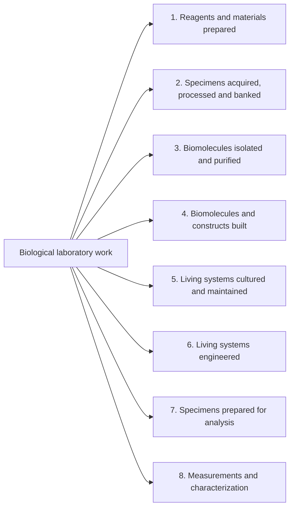
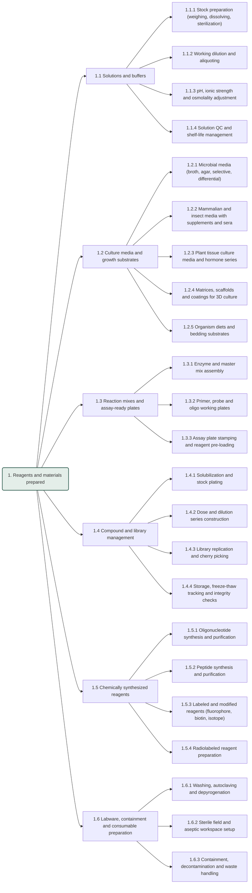
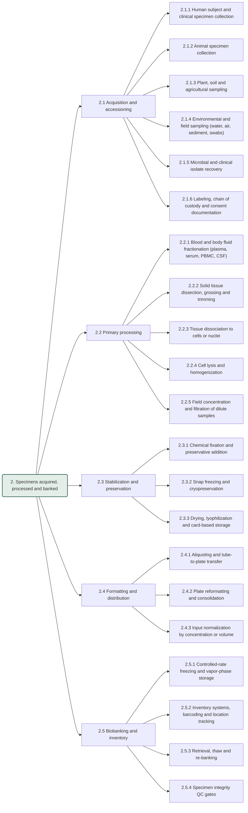
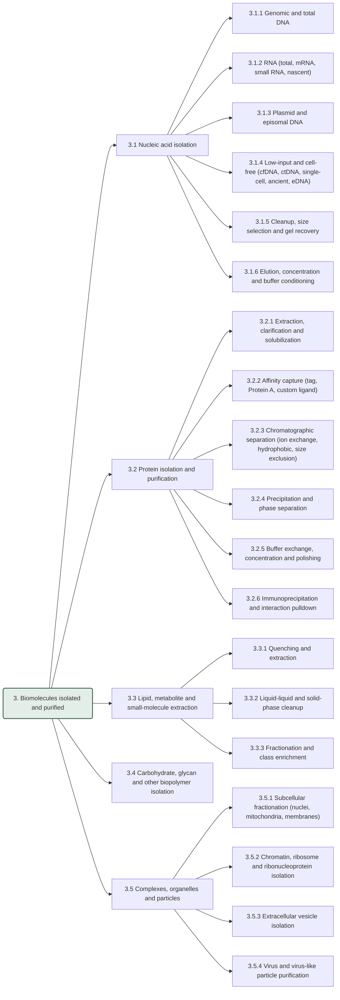
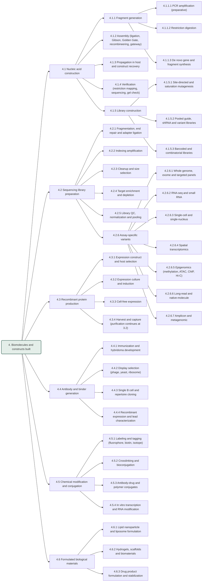
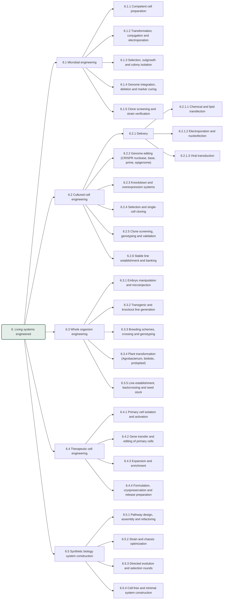

# Biological Workflow Map

A structural map of what wet labs and life science companies do at the bench, organized so that every workflow has exactly one place.

**[Browse the interactive map](https://cykim5.github.io/bio-workflow-taxonomy/)**

## The rule

**Every workflow is filed under the kind of thing it exists to produce.**

Research field, technique and instrument all overlap, so an ELISA belongs to immunology, cancer biology and bioprocess at the same time. Output does not overlap: a workflow produces purified RNA, or an engineered cell line, or a number, but never two at once. That single rule is what keeps the branches mutually exclusive.

Everything that does overlap becomes a lens instead: research area, function, setting, scale, regulatory regime, unit operation, and material acted on.

## The eight domains



They run in order from inputs to answers. 8 domains, 264 workflows, up to 4 levels deep.

| Domain | Output |
|---|---|
| 1. Reagents and materials prepared | A ready-to-use input for other work |
| 2. Specimens acquired, processed and banked | A specimen ready to use or ready to store |
| 3. Biomolecules isolated and purified | A purified, naturally occurring biomolecule or particle |
| 4. Biomolecules and constructs built | A biomolecule that did not exist before this work |
| 5. Living systems cultured and maintained | A living, propagated biological system |
| 6. Living systems engineered | A system whose genome or composition has been changed |
| 7. Specimens prepared for analysis | A specimen in the exact form an instrument requires |
| 8. Measurements and characterization | Data about a sample, system or organism |

A fuller diagram covering the second level is in [diagram.mmd](diagram.mmd).

## What sits inside each domain

One diagram per domain, showing every subsection down to the deepest level.
These render as graphics on GitHub but are not clickable, since GitHub strips
interactivity from Mermaid. For a version you can click through, open the
[interactive map](https://cykim5.github.io/bio-workflow-taxonomy/).

<!-- BEGIN BRANCHES -->
<!-- Generated by build.py. Edit TAXONOMY.md, then rerun it. -->

### 1. Reagents and materials prepared

*Output: a ready-to-use input for other work.*

23 workflows in 6 branches.



### 2. Specimens acquired, processed and banked

*Output: a biological specimen that is ready to use or ready to store.*

21 workflows in 5 branches.



### 3. Biomolecules isolated and purified

*Output: a purified, naturally occurring biomolecule or particle.*

20 workflows in 5 branches.



### 4. Biomolecules and constructs built

*Output: a biomolecule that did not exist before this work.*

36 workflows in 6 branches.



### 5. Living systems cultured and maintained

*Output: a living, propagated biological system.*

39 workflows in 7 branches.

```mermaid
flowchart LR
    N5("5. Living systems cultured and maintained")
    N5 --> N5_1["5.1 Microbial culture"]
    N5_1 --> N5_1_1["5.1.1 Isolation, streaking and single-colony recovery"]
    N5_1 --> N5_1_2["5.1.2 Liquid culture, growth monitoring and induction"]
    N5_1 --> N5_1_3["5.1.3 Anaerobic, fastidious and extremophile culture"]
    N5_1 --> N5_1_4["5.1.4 Consortia, microbiome and enrichment culture"]
    N5_1 --> N5_1_5["5.1.5 Bacteriophage propagation"]
    N5_1 --> N5_1_6["5.1.6 Strain banking and revival"]
    N5 --> N5_2["5.2 Animal cell culture"]
    N5_2 --> N5_2_1["5.2.1 Thaw, seeding and establishment"]
    N5_2 --> N5_2_2["5.2.2 Feeding, passaging and expansion"]
    N5_2 --> N5_2_3["5.2.3 Suspension and bioreactor-adapted culture"]
    N5_2 --> N5_2_4["5.2.4 Primary cell isolation and culture"]
    N5_2 --> N5_2_5["5.2.5 Co-culture and conditioned media systems"]
    N5_2 --> N5_2_6["5.2.6 Cell banking (master and working banks)"]
    N5_2 --> N5_2_7["5.2.7 Identity, mycoplasma and sterility monitoring"]
    N5 --> N5_3["5.3 Stem cell and advanced in vitro models"]
    N5_3 --> N5_3_1["5.3.1 Pluripotent stem cell derivation and maintenance"]
    N5_3 --> N5_3_2["5.3.2 Directed differentiation"]
    N5_3 --> N5_3_3["5.3.3 Organoid establishment, passaging and maturation"]
    N5_3 --> N5_3_4["5.3.4 3D, scaffold and bioprinted culture"]
    N5_3 --> N5_3_5["5.3.5 Organ-on-chip and perfused systems"]
    N5_3 --> N5_3_6["5.3.6 Tissue explant and slice culture"]
    N5 --> N5_4["5.4 Plant and algal culture"]
    N5_4 --> N5_4_1["5.4.1 Sterile seed, explant and callus culture"]
    N5_4 --> N5_4_2["5.4.2 Regeneration, rooting and acclimatization"]
    N5_4 --> N5_4_3["5.4.3 Hydroponic and controlled-environment growth"]
    N5_4 --> N5_4_4["5.4.4 Greenhouse and field propagation"]
    N5 --> N5_5["5.5 Virus and vector propagation"]
    N5_5 --> N5_5_1["5.5.1 Virus isolation and propagation in host cells"]
    N5_5 --> N5_5_2["5.5.2 Viral vector production (lentivirus, AAV, adenovirus)"]
    N5_5 --> N5_5_3["5.5.3 Harvest, concentration and purification"]
    N5_5 --> N5_5_4["5.5.4 High-containment propagation"]
    N5 --> N5_6["5.6 Whole organism husbandry"]
    N5_6 --> N5_6_1["5.6.1 Rodent colony management and breeding"]
    N5_6 --> N5_6_2["5.6.2 Non-mammalian models (zebrafish, Drosophila, C. elegans, Xenopus)"]
    N5_6 --> N5_6_3["5.6.3 Insects, arthropods and vectors"]
    N5_6 --> N5_6_4["5.6.4 Gnotobiotic and germ-free systems"]
    N5_6 --> N5_6_5["5.6.5 Aquatic, avian and large animal systems"]
    N5_6 --> N5_6_6["5.6.6 Health monitoring, welfare and colony QC"]
    N5 --> N5_7["5.7 Scaled culture and bioprocessing"]
    N5_7 --> N5_7_1["5.7.1 Inoculum development and seed train"]
    N5_7 --> N5_7_2["5.7.2 Bioreactor operation, feeding and control"]
    N5_7 --> N5_7_3["5.7.3 In-process monitoring and sampling"]
    N5_7 --> N5_7_4["5.7.4 Harvest and clarification"]
    N5_7 --> N5_7_5["5.7.5 Downstream processing at scale"]
    N5_7 --> N5_7_6["5.7.6 Formulation, fill and finish"]
    class N5 domain;
    classDef domain fill:#e4eee9,stroke:#2f5d50,stroke-width:2px;
```



### 6. Living systems engineered

*Output: a biological system whose genome or composition has been changed.*

26 workflows in 5 branches.



### 7. Specimens prepared for analysis

*Output: a specimen in the exact physical form an instrument requires.*

43 workflows in 8 branches.

```mermaid
flowchart LR
    N7("7. Specimens prepared for analysis")
    N7 --> N7_1["7.1 Histology and pathology preparation"]
    N7_1 --> N7_1_1["7.1.1 Fixation, decalcification and grossing"]
    N7_1 --> N7_1_2["7.1.2 Processing, embedding and block preparation"]
    N7_1 --> N7_1_3["7.1.3 Sectioning (microtome, cryostat, vibratome)"]
    N7_1 --> N7_1_4["7.1.4 Routine and special staining"]
    N7_1 --> N7_1_5["7.1.5 Immunohistochemistry and multiplex immunofluorescence"]
    N7_1 --> N7_1_6["7.1.6 In situ hybridization on sections"]
    N7_1 --> N7_1_7["7.1.7 Coverslipping and slide finishing"]
    N7_1 --> N7_1_8["7.1.8 Tissue microarray construction"]
    N7 --> N7_2["7.2 Light microscopy preparation"]
    N7_2 --> N7_2_1["7.2.1 Fixation and permeabilization"]
    N7_2 --> N7_2_2["7.2.2 Immunofluorescence and dye labeling"]
    N7_2 --> N7_2_3["7.2.3 FISH and in situ detection"]
    N7_2 --> N7_2_4["7.2.4 Clearing and expansion"]
    N7_2 --> N7_2_5["7.2.5 Mounting and slide assembly"]
    N7_2 --> N7_2_6["7.2.6 Live-imaging chamber and dish setup"]
    N7 --> N7_3["7.3 Electron microscopy preparation"]
    N7_3 --> N7_3_1["7.3.1 Chemical fixation and en bloc staining"]
    N7_3 --> N7_3_2["7.3.2 High-pressure freezing and freeze substitution"]
    N7_3 --> N7_3_3["7.3.3 Dehydration, infiltration and resin embedding"]
    N7_3 --> N7_3_4["7.3.4 Ultramicrotomy and grid mounting"]
    N7_3 --> N7_3_5["7.3.5 Negative staining and post-section staining"]
    N7_3 --> N7_3_6["7.3.6 Immunogold labeling"]
    N7 --> N7_4["7.4 Structural biology preparation"]
    N7_4 --> N7_4_1["7.4.1 Sample homogeneity and stability screening"]
    N7_4 --> N7_4_2["7.4.2 Crystallization screening and optimization"]
    N7_4 --> N7_4_3["7.4.3 Crystal harvesting and cryoprotection"]
    N7_4 --> N7_4_4["7.4.4 Cryo-EM grid preparation and vitrification"]
    N7_4 --> N7_4_5["7.4.5 Grid clipping, screening and storage"]
    N7_4 --> N7_4_6["7.4.6 NMR and solution scattering sample preparation"]
    N7 --> N7_5["7.5 Cytometry preparation"]
    N7_5 --> N7_5_1["7.5.1 Single-cell suspension and debris removal"]
    N7_5 --> N7_5_2["7.5.2 Surface and intracellular antibody staining"]
    N7_5 --> N7_5_3["7.5.3 Fixation, permeabilization and viability dyes"]
    N7_5 --> N7_5_4["7.5.4 Compensation and control panels"]
    N7_5 --> N7_5_5["7.5.5 Mass cytometry labeling and barcoding"]
    N7 --> N7_6["7.6 Mass spectrometry and chromatography preparation"]
    N7_6 --> N7_6_1["7.6.1 Reduction, alkylation and proteolytic digestion"]
    N7_6 --> N7_6_2["7.6.2 Peptide cleanup, desalting and fractionation"]
    N7_6 --> N7_6_3["7.6.3 Post-translational modification enrichment"]
    N7_6 --> N7_6_4["7.6.4 Isobaric and metabolic labeling"]
    N7_6 --> N7_6_5["7.6.5 Metabolite and lipid extract conditioning"]
    N7_6 --> N7_6_6["7.6.6 Derivatization and vial or plate loading"]
    N7 --> N7_7["7.7 Electrophoresis and blotting preparation"]
    N7_7 --> N7_7_1["7.7.1 Sample denaturation and loading preparation"]
    N7_7 --> N7_7_2["7.7.2 Gel casting and assembly"]
    N7_7 --> N7_7_3["7.7.3 Transfer, membrane blocking and probing"]
    N7 --> N7_8["7.8 Spatial and correlative preparation"]
    N7_8 --> N7_8_1["7.8.1 Spatial omics slide preparation"]
    N7_8 --> N7_8_2["7.8.2 Laser capture microdissection"]
    N7_8 --> N7_8_3["7.8.3 Correlative and multimodal specimen preparation"]
    class N7 domain;
    classDef domain fill:#e4eee9,stroke:#2f5d50,stroke-width:2px;
```



### 8. Measurements and characterization

*Output: data about a sample, system or organism.*

56 workflows in 12 branches.

```mermaid
flowchart LR
    N8("8. Measurements and characterization")
    N8 --> N8_1["8.1 Quantity, quality and integrity assays"]
    N8_1 --> N8_1_1["8.1.1 Nucleic acid concentration and integrity"]
    N8_1 --> N8_1_2["8.1.2 Protein concentration and purity"]
    N8_1 --> N8_1_3["8.1.3 Cell counting, viability and confluency"]
    N8_1 --> N8_1_4["8.1.4 Contamination testing (endotoxin, mycoplasma, sterility, bioburden)"]
    N8 --> N8_2["8.2 Amplification-based detection and quantification"]
    N8_2 --> N8_2_1["8.2.1 qPCR and RT-qPCR"]
    N8_2 --> N8_2_2["8.2.2 Digital PCR"]
    N8_2 --> N8_2_3["8.2.3 Isothermal and point-of-care amplification"]
    N8_2 --> N8_2_4["8.2.4 Melt curve and genotyping assays"]
    N8 --> N8_3["8.3 Sequencing readout"]
    N8_3 --> N8_3_1["8.3.1 Short-read sequencing runs"]
    N8_3 --> N8_3_2["8.3.2 Long-read and native-molecule sequencing"]
    N8_3 --> N8_3_3["8.3.3 Sanger sequencing and fragment analysis"]
    N8_3 --> N8_3_4["8.3.4 Run QC and base-level quality assessment"]
    N8 --> N8_4["8.4 Separation-based analysis"]
    N8_4 --> N8_4_1["8.4.1 Agarose and polyacrylamide gel analysis"]
    N8_4 --> N8_4_2["8.4.2 Western blot detection"]
    N8_4 --> N8_4_3["8.4.3 Capillary and microfluidic electrophoresis"]
    N8_4 --> N8_4_4["8.4.4 Liquid and gas chromatography"]
    N8_4 --> N8_4_5["8.4.5 Mass spectrometry acquisition"]
    N8 --> N8_5["8.5 Binding, immunoassay and interaction analysis"]
    N8_5 --> N8_5_1["8.5.1 ELISA and sandwich immunoassays"]
    N8_5 --> N8_5_2["8.5.2 Multiplex bead and array immunoassays"]
    N8_5 --> N8_5_3["8.5.3 Lateral flow and rapid tests"]
    N8_5 --> N8_5_4["8.5.4 Label-free binding kinetics (SPR, BLI)"]
    N8_5 --> N8_5_5["8.5.5 Thermodynamic and stability assays (ITC, thermal shift)"]
    N8 --> N8_6["8.6 Cell-based and functional assays"]
    N8_6 --> N8_6_1["8.6.1 Viability, proliferation and cytotoxicity"]
    N8_6 --> N8_6_2["8.6.2 Reporter and signaling pathway assays"]
    N8_6 --> N8_6_3["8.6.3 Enzyme activity and kinetics"]
    N8_6 --> N8_6_4["8.6.4 Migration, invasion and adhesion"]
    N8_6 --> N8_6_5["8.6.5 Differentiation, potency and colony-forming assays"]
    N8_6 --> N8_6_6["8.6.6 Dose response and drug combination studies"]
    N8_6 --> N8_6_7["8.6.7 Pooled and arrayed screening campaigns"]
    N8 --> N8_7["8.7 Cytometry acquisition"]
    N8_7 --> N8_7_1["8.7.1 Conventional and spectral flow acquisition"]
    N8_7 --> N8_7_2["8.7.2 Cell sorting and single-cell deposition"]
    N8_7 --> N8_7_3["8.7.3 Mass cytometry acquisition"]
    N8 --> N8_8["8.8 Imaging acquisition"]
    N8_8 --> N8_8_1["8.8.1 Widefield, confocal and super-resolution microscopy"]
    N8_8 --> N8_8_2["8.8.2 Live-cell and time-lapse imaging"]
    N8_8 --> N8_8_3["8.8.3 High-content and automated imaging"]
    N8_8 --> N8_8_4["8.8.4 Electron microscopy and tomography acquisition"]
    N8_8 --> N8_8_5["8.8.5 Whole-slide scanning and digital pathology capture"]
    N8_8 --> N8_8_6["8.8.6 In vivo and preclinical imaging"]
    N8 --> N8_9["8.9 Structural and biophysical characterization"]
    N8_9 --> N8_9_1["8.9.1 X-ray diffraction data collection"]
    N8_9 --> N8_9_2["8.9.2 Cryo-EM data collection"]
    N8_9 --> N8_9_3["8.9.3 NMR spectroscopy"]
    N8_9 --> N8_9_4["8.9.4 Circular dichroism and optical spectroscopy"]
    N8_9 --> N8_9_5["8.9.5 Light scattering, analytical ultracentrifugation, calorimetry"]
    N8 --> N8_10["8.10 Electrophysiology and biosensing"]
    N8_10 --> N8_10_1["8.10.1 Manual and automated patch clamp"]
    N8_10 --> N8_10_2["8.10.2 Multi-electrode array and impedance"]
    N8_10 --> N8_10_3["8.10.3 Electrochemical and optical biosensors"]
    N8 --> N8_11["8.11 Microbial and organism phenotyping"]
    N8_11 --> N8_11_1["8.11.1 Enumeration and viability plating"]
    N8_11 --> N8_11_2["8.11.2 Growth kinetics and fitness assays"]
    N8_11 --> N8_11_3["8.11.3 Antimicrobial susceptibility testing"]
    N8_11 --> N8_11_4["8.11.4 Identification and biochemical panels"]
    N8_11 --> N8_11_5["8.11.5 Morphometric and behavioral phenotyping"]
    N8 --> N8_12["8.12 In vivo study execution and readout"]
    N8_12 --> N8_12_1["8.12.1 Dosing and administration"]
    N8_12 --> N8_12_2["8.12.2 In-life sampling and pharmacokinetics"]
    N8_12 --> N8_12_3["8.12.3 Physiological and behavioral monitoring"]
    N8_12 --> N8_12_4["8.12.4 Model induction and challenge studies"]
    N8_12 --> N8_12_5["8.12.5 Terminal procedures and tissue collection"]
    class N8 domain;
    classDef domain fill:#e4eee9,stroke:#2f5d50,stroke-width:2px;
```



<!-- END BRANCHES -->

## Where the hard cases land

The three techniques that break most taxonomies each land cleanly, because the rule asks what the work produces rather than what it uses.

| Technique | Where it goes | Why |
|---|---|---|
| PCR to make DNA for a later step | 4.1.1.1 Fragment generation | Output is DNA |
| qPCR to produce a number | 8.2.1 qPCR and RT-qPCR | Output is data |
| Gel run to recover a band | 3.1.5 Cleanup, size selection and gel recovery | Output is DNA |
| Gel run to report a size | 8.4.1 Agarose and polyacrylamide gel analysis | Output is data |
| Centrifuging, mixing, incubating | Not in the tree | Single operations are steps, not workflows |

## Files

| File | What it is |
|---|---|
| [`TAXONOMY.md`](TAXONOMY.md) | Source of truth: the full tree, the lenses, and a critical review |
| [`lenses.yaml`](lenses.yaml) | Research area and material tags, keyed by node id |
| [`build.py`](build.py) | Generates `docs/taxonomy.json` and `diagram.mmd` from the two files above |
| [`docs/`](docs/) | The interactive map, published with GitHub Pages |
| [`docs/taxonomy.json`](docs/taxonomy.json) | The tree as data, for loading into other tools |

Rebuild after editing the tree or the tags:

```bash
python3 build.py
```

Preview the page locally:

```bash
python3 -m http.server --directory docs 8000
```

## Status and limitations

This is a synthesis, not a published standard. It draws on how formal ontologies (OBI, EFO, BAO, MeSH), protocol publishers, automation vendors, university departments and core facilities, and industry R&D organizations structure lab work, but no existing taxonomy covers wet-lab workflows as a whole, so there is nothing to validate it against directly.

Known weaknesses, stated plainly:

- **Domain 8 is overloaded.** Twelve children spanning a plate reader and a cryo-EM session. "Data" is a coarser output category than "purified protein."
- **Domains 7 and 8 have a soft seam.** Staining a slide and imaging it feel like one activity to the person doing them.
- **Depth is uneven.** Nucleic acid work reaches four levels because that is where the most documented protocols exist, not because it matters more. Carbohydrate work, biosensing and therapeutic cell engineering are thin.
- **The tie-break rules are reasoned, not cited.** Only the top-level output split has ontology precedent.

**The test that would settle it:** assign several hundred real published protocols to leaves. Three numbers decide whether the structure works, namely the share landing in exactly one leaf, the share fitting two or more (rule violations), and the share fitting none (missing branches). Agreement between two independent people assigning the same protocols tests whether the rule is teachable, which is the real bar for a taxonomy meant for others to use.

## Scope

Wet-lab work only, meaning anything performed on physical biological material.

Deliberately excluded: bioinformatics and computational biology, biostatistics, modeling and simulation, structure prediction, image analysis, cheminformatics, laboratory information systems, database curation, and clinical patient-facing procedures. A complete picture of a modern lab would add these as a parallel tree rather than as branches inside this one.
