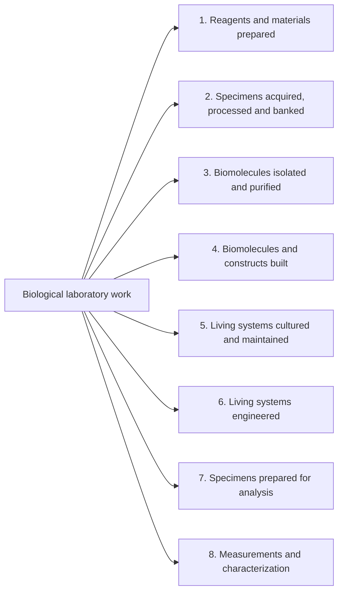

# Biological Workflow Map

A structural map of what wet labs and life science companies do at the bench, organized so that every workflow has exactly one place.

**[Browse the interactive map](https://cykim5.github.io/bio-workflow-taxonomy/)**

## The rule

**Every workflow is filed under the kind of thing it exists to produce.**

Research field, technique and instrument all overlap, so an ELISA belongs to immunology, cancer biology and bioprocess at the same time. Output does not overlap: a workflow produces purified RNA, or an engineered cell line, or a number, but never two at once. That single rule is what keeps the branches mutually exclusive.

Everything that does overlap becomes a lens instead: research area, function, setting, scale, regulatory regime, unit operation, and material acted on.

## The eight domains



They run in order from inputs to answers. 8 domains, 264 workflows, up to 4 levels deep.

| Domain | Output |
|---|---|
| 1. Reagents and materials prepared | A ready-to-use input for other work |
| 2. Specimens acquired, processed and banked | A specimen ready to use or ready to store |
| 3. Biomolecules isolated and purified | A purified, naturally occurring biomolecule or particle |
| 4. Biomolecules and constructs built | A biomolecule that did not exist before this work |
| 5. Living systems cultured and maintained | A living, propagated biological system |
| 6. Living systems engineered | A system whose genome or composition has been changed |
| 7. Specimens prepared for analysis | A specimen in the exact form an instrument requires |
| 8. Measurements and characterization | Data about a sample, system or organism |

A fuller diagram covering the second level is in [diagram.mmd](diagram.mmd).

## What sits inside each domain

The branches below are level two. Each one opens further in the
[interactive map](https://cykim5.github.io/bio-workflow-taxonomy/) and in
[TAXONOMY.md](TAXONOMY.md), down to four levels in places. The count is how many
individual workflows sit under that branch.

<!-- BEGIN BRANCHES -->
<!-- Generated by build.py. Edit TAXONOMY.md, then rerun it. -->

### 1. Reagents and materials prepared

*Output: a ready-to-use input for other work.*

| Branch | Workflows |
|---|---|
| 1.1 Solutions and buffers | 4 |
| 1.2 Culture media and growth substrates | 5 |
| 1.3 Reaction mixes and assay-ready plates | 3 |
| 1.4 Compound and library management | 4 |
| 1.5 Chemically synthesized reagents | 4 |
| 1.6 Labware, containment and consumable preparation | 3 |

### 2. Specimens acquired, processed and banked

*Output: a biological specimen that is ready to use or ready to store.*

| Branch | Workflows |
|---|---|
| 2.1 Acquisition and accessioning | 6 |
| 2.2 Primary processing | 5 |
| 2.3 Stabilization and preservation | 3 |
| 2.4 Formatting and distribution | 3 |
| 2.5 Biobanking and inventory | 4 |

### 3. Biomolecules isolated and purified

*Output: a purified, naturally occurring biomolecule or particle.*

| Branch | Workflows |
|---|---|
| 3.1 Nucleic acid isolation | 6 |
| 3.2 Protein isolation and purification | 6 |
| 3.3 Lipid, metabolite and small-molecule extraction | 3 |
| 3.4 Carbohydrate, glycan and other biopolymer isolation | 1 |
| 3.5 Complexes, organelles and particles | 4 |

### 4. Biomolecules and constructs built

*Output: a biomolecule that did not exist before this work.*

| Branch | Workflows |
|---|---|
| 4.1 Nucleic acid construction | 9 |
| 4.2 Sequencing library preparation | 12 |
| 4.3 Recombinant protein production | 4 |
| 4.4 Antibody and binder generation | 4 |
| 4.5 Chemical modification and conjugation | 4 |
| 4.6 Formulated biological materials | 3 |

### 5. Living systems cultured and maintained

*Output: a living, propagated biological system.*

| Branch | Workflows |
|---|---|
| 5.1 Microbial culture | 6 |
| 5.2 Animal cell culture | 7 |
| 5.3 Stem cell and advanced in vitro models | 6 |
| 5.4 Plant and algal culture | 4 |
| 5.5 Virus and vector propagation | 4 |
| 5.6 Whole organism husbandry | 6 |
| 5.7 Scaled culture and bioprocessing | 6 |

### 6. Living systems engineered

*Output: a biological system whose genome or composition has been changed.*

| Branch | Workflows |
|---|---|
| 6.1 Microbial engineering | 5 |
| 6.2 Cultured cell engineering | 8 |
| 6.3 Whole organism engineering | 5 |
| 6.4 Therapeutic cell engineering | 4 |
| 6.5 Synthetic biology system construction | 4 |

### 7. Specimens prepared for analysis

*Output: a specimen in the exact physical form an instrument requires.*

| Branch | Workflows |
|---|---|
| 7.1 Histology and pathology preparation | 8 |
| 7.2 Light microscopy preparation | 6 |
| 7.3 Electron microscopy preparation | 6 |
| 7.4 Structural biology preparation | 6 |
| 7.5 Cytometry preparation | 5 |
| 7.6 Mass spectrometry and chromatography preparation | 6 |
| 7.7 Electrophoresis and blotting preparation | 3 |
| 7.8 Spatial and correlative preparation | 3 |

### 8. Measurements and characterization

*Output: data about a sample, system or organism.*

| Branch | Workflows |
|---|---|
| 8.1 Quantity, quality and integrity assays | 4 |
| 8.2 Amplification-based detection and quantification | 4 |
| 8.3 Sequencing readout | 4 |
| 8.4 Separation-based analysis | 5 |
| 8.5 Binding, immunoassay and interaction analysis | 5 |
| 8.6 Cell-based and functional assays | 7 |
| 8.7 Cytometry acquisition | 3 |
| 8.8 Imaging acquisition | 6 |
| 8.9 Structural and biophysical characterization | 5 |
| 8.10 Electrophysiology and biosensing | 3 |
| 8.11 Microbial and organism phenotyping | 5 |
| 8.12 In vivo study execution and readout | 5 |

<!-- END BRANCHES -->

## Where the hard cases land

The three techniques that break most taxonomies each land cleanly, because the rule asks what the work produces rather than what it uses.

| Technique | Where it goes | Why |
|---|---|---|
| PCR to make DNA for a later step | 4.1.1.1 Fragment generation | Output is DNA |
| qPCR to produce a number | 8.2.1 qPCR and RT-qPCR | Output is data |
| Gel run to recover a band | 3.1.5 Cleanup, size selection and gel recovery | Output is DNA |
| Gel run to report a size | 8.4.1 Agarose and polyacrylamide gel analysis | Output is data |
| Centrifuging, mixing, incubating | Not in the tree | Single operations are steps, not workflows |

## Files

| File | What it is |
|---|---|
| [`TAXONOMY.md`](TAXONOMY.md) | Source of truth: the full tree, the lenses, and a critical review |
| [`lenses.yaml`](lenses.yaml) | Research area and material tags, keyed by node id |
| [`build.py`](build.py) | Generates `docs/taxonomy.json` and `diagram.mmd` from the two files above |
| [`docs/`](docs/) | The interactive map, published with GitHub Pages |
| [`docs/taxonomy.json`](docs/taxonomy.json) | The tree as data, for loading into other tools |

Rebuild after editing the tree or the tags:

```bash
python3 build.py
```

Preview the page locally:

```bash
python3 -m http.server --directory docs 8000
```

## Status and limitations

This is a synthesis, not a published standard. It draws on how formal ontologies (OBI, EFO, BAO, MeSH), protocol publishers, automation vendors, university departments and core facilities, and industry R&D organizations structure lab work, but no existing taxonomy covers wet-lab workflows as a whole, so there is nothing to validate it against directly.

Known weaknesses, stated plainly:

- **Domain 8 is overloaded.** Twelve children spanning a plate reader and a cryo-EM session. "Data" is a coarser output category than "purified protein."
- **Domains 7 and 8 have a soft seam.** Staining a slide and imaging it feel like one activity to the person doing them.
- **Depth is uneven.** Nucleic acid work reaches four levels because that is where the most documented protocols exist, not because it matters more. Carbohydrate work, biosensing and therapeutic cell engineering are thin.
- **The tie-break rules are reasoned, not cited.** Only the top-level output split has ontology precedent.

**The test that would settle it:** assign several hundred real published protocols to leaves. Three numbers decide whether the structure works, namely the share landing in exactly one leaf, the share fitting two or more (rule violations), and the share fitting none (missing branches). Agreement between two independent people assigning the same protocols tests whether the rule is teachable, which is the real bar for a taxonomy meant for others to use.

## Scope

Wet-lab work only, meaning anything performed on physical biological material.

Deliberately excluded: bioinformatics and computational biology, biostatistics, modeling and simulation, structure prediction, image analysis, cheminformatics, laboratory information systems, database curation, and clinical patient-facing procedures. A complete picture of a modern lab would add these as a parallel tree rather than as branches inside this one.
