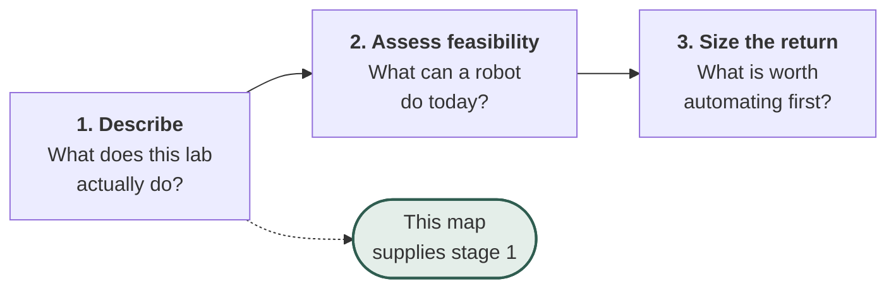
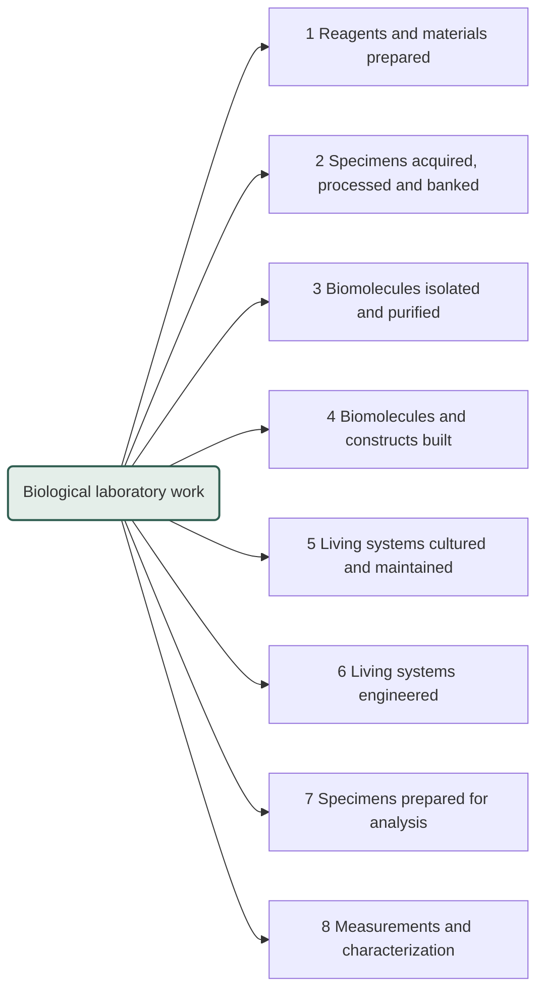

# Biological Workflow Map

**A MECE map of what happens at a biology bench.** Every workflow in a wet lab, sorted so that each one has exactly one place: mutually exclusive, so nothing is double counted, and collectively exhaustive, so nothing is missed.

8 domains. 264 workflows. 4 levels deep.

**[Browse the interactive map](https://cykim5.github.io/bio-workflow-taxonomy/)** or read the full tree in **[TAXONOMY.md](TAXONOMY.md)**.

## Why this exists

This is the base layer of a larger project on **lab automation assessment**: working out which parts of a given lab are worth automating, and what the return would be.

That assessment runs in three stages, and each one depends on the stage before it.



A lab describes its work in its own words. Those words have to resolve to a shared set of workflows before anything can be scored, compared across labs, or aggregated into a benchmark. **Without a MECE base, the analysis breaks in two specific ways:**

| Failure | Cause | Consequence |
|---|---|---|
| Double counting | The same workflow sits in two categories | Savings are counted twice, and the business case inflates |
| Blind spots | No category fits a real workflow | The biggest opportunity is invisible because nothing captures it |

Automation feasibility and cost are therefore deliberately **not** in this map. They are attributes measured against it, which keeps the structure stable as robots improve. A workflow that is manual today and automated in three years does not move branches; only its score changes.

## The problem with existing classifications

Biology already has many ways to group lab work. None of them is MECE, because each mixes several axes at the same level.

| Source | How it splits | Why it overlaps |
|---|---|---|
| Protocol publishers | Research field | One ELISA is immunology, cancer biology and bioprocess at once |
| Equipment vendors | Application and technique | "NGS" and "liquid transfer" are not the same kind of thing |
| University departments | Biological question | Two labs asking different questions run identical bench work |
| Method ontologies | Mixed, at the top level | Centrifugation appears as a sibling of whole disciplines |

Each is useful for finding a paper or buying an instrument. None can carry analysis, because a workflow counted in three places cannot be counted once.

## The rule

**Every workflow is filed under the kind of thing it exists to produce.**

Output is the one attribute that does not overlap. A workflow yields purified RNA, or an engineered cell line, or a number, but never two at once. Field, technique and instrument all overlap, so they become filters over the map instead of branches in it.

Four tie-breaks keep the rule decidable at the edges.

| Tie-break | Rule | Worked example |
|---|---|---|
| 1. Generic beats specialized | Shared outputs live in the generic branch, whatever field uses them | DNA extraction for an eDNA study is still DNA extraction |
| 2. Two outputs, two homes | A technique used both to make material and to measure it splits in two | Preparative PCR is construction, qPCR is measurement |
| 3. Operations are not workflows | Single physical actions are steps, not categories | Centrifuging, mixing, sealing, reading a plate |
| 4. Scale and setting are filters | Volume and context do not create branches | A 5 mL culture and a 2,000 L bioreactor share a branch |

**The hard cases are the test.** PCR, gels and centrifugation break most taxonomies. Here each has one address.

| Activity | Where it lands | Why |
|---|---|---|
| PCR to make DNA for a later step | 4.1.1.1 Fragment generation | Output is material |
| qPCR to produce a number | 8.2.1 qPCR and RT-qPCR | Output is data |
| Gel run to recover a band | 3.1.5 Cleanup, size selection and gel recovery | Output is material |
| Gel run to report a size | 8.4.1 Agarose and polyacrylamide gel analysis | Output is data |
| Centrifuging, mixing, incubating | Not in the map | Steps, not workflows |

## The map

<!-- BEGIN BRANCHES -->
<!-- Generated by build.py. Edit TAXONOMY.md, then rerun it. -->



| # | Domain | Output it produces | Branches | Workflows |
|---|---|---|---|---|
| 1 | **Reagents and materials prepared** | A ready-to-use input for other work | 6 | 23 |
| 2 | **Specimens acquired, processed and banked** | A biological specimen that is ready to use or ready to store | 5 | 21 |
| 3 | **Biomolecules isolated and purified** | A purified, naturally occurring biomolecule or particle | 5 | 20 |
| 4 | **Biomolecules and constructs built** | A biomolecule that did not exist before this work | 6 | 36 |
| 5 | **Living systems cultured and maintained** | A living, propagated biological system | 7 | 39 |
| 6 | **Living systems engineered** | A biological system whose genome or composition has been changed | 5 | 26 |
| 7 | **Specimens prepared for analysis** | A specimen in the exact physical form an instrument requires | 8 | 43 |
| 8 | **Measurements and characterization** | Data about a sample, system or organism | 12 | 56 |

<!-- END BRANCHES -->

The domains run in order from inputs to answers. Each opens into branches and individual workflows in **[TAXONOMY.md](TAXONOMY.md)** and in the [interactive map](https://cykim5.github.io/bio-workflow-taxonomy/).

## The filters

Everything that legitimately overlaps is a tag, not a branch. A workflow can carry any number from each.

| Filter | Examples |
|---|---|
| Research area | Immunology, genomics, neuroscience, cancer biology, 19 in total |
| Function | Discovery, assay development, screening, process development, QC, manufacturing |
| Setting | Academic lab, core facility, biotech R&D, CRO, clinical lab, manufacturing site |
| Scale | Single sample, plate-based, high throughput, pilot, manufacturing |
| Regulatory regime | Research use only, GLP, CLIA, GMP, biosafety level |
| Unit operation | Liquid transfer, separation, thermal cycling, detection, object manipulation |
| Material acted on | Nucleic acid, protein, cell, tissue, organism, data |

The last two are what the downstream assessment scores. **Automation feasibility attaches to unit operations, not to workflows**, which is why a workflow usually earns a mixed verdict rather than a yes or no: the liquid transfers automate, the object handling does not.

## Repository

| File | What it is |
|---|---|
| [`TAXONOMY.md`](TAXONOMY.md) | Source of truth: the rule, the full tree, the filters |
| [`lenses.yaml`](lenses.yaml) | Filter tags, keyed by node id |
| [`build.py`](build.py) | Regenerates the data, the diagram and this README's map section |
| [`docs/`](docs/) | The interactive map |
| [`docs/taxonomy.json`](docs/taxonomy.json) | The map as data, for loading into other tools |

```bash
python3 build.py                              # rebuild after editing the tree
python3 -m http.server --directory docs 8000  # preview the interactive map
```

## Status

A synthesis, not a published standard. It reconciles how method ontologies, protocol publishers, equipment vendors, university core facilities and industry R&D functions structure lab work, but no existing taxonomy covers wet-lab workflows as a whole, so there is nothing to validate it against directly.

Known weaknesses:

- **Domain 8 is the widest.** Twelve branches spanning a plate reader and a cryo-EM session. "Data" is a coarser output than "purified protein."
- **Domains 7 and 8 share a soft seam.** Staining a slide and imaging it feel like one activity to the person doing them.
- **Depth is uneven.** Nucleic acid work reaches four levels because that is where documented protocols concentrate, not because it matters more.
- **The tie-breaks are reasoned, not cited.** Only the top-level split has ontology precedent.

**The test that would settle it:** assign several hundred published protocols to leaves and measure three things, namely the share landing in exactly one leaf, the share fitting two or more (overlap), and the share fitting none (gaps). Agreement between two independent people assigning the same protocols tests whether the rule is teachable, which is the real bar for a structure meant for others to use.

## Scope

Wet-lab work only, meaning anything performed on physical biological material.

Deliberately excluded: bioinformatics and computational biology, biostatistics, modeling and simulation, structure prediction, image analysis, cheminformatics, laboratory information systems, and clinical patient-facing procedures. A complete picture of a modern lab would add these as a parallel map rather than as branches inside this one.
